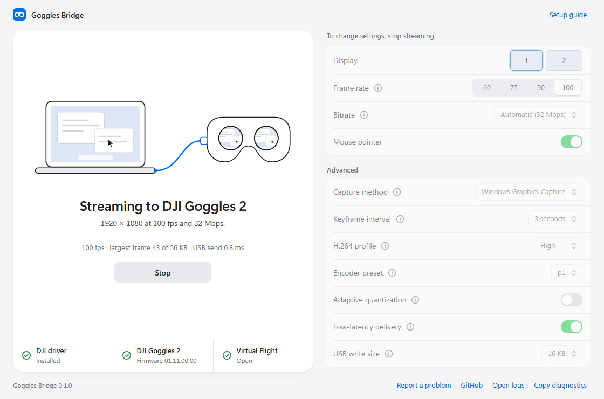

# G2 Bridge

Stream your Windows or Mac desktop to DJI Goggles 2 or DJI Goggles Integra over USB. The goggles use Virtual Flight mode with stock firmware. The simulator and controller run on the computer.

The bridge detects the model when it connects:

| Goggles | Identity | Tested firmware |
| --- | --- | --- |
| DJI Goggles 2 | `E3T ZV900` | 01.11.00.00, 01.14.00.00 |
| DJI Goggles Integra | `E3T ZV901` | 01.09.00.00 |
| DJI FPV Goggles V2 | `WM170 PIGEON` | detected, control works; **no video on stock firmware**. See [other goggles](#other-goggles) |

Goggles 2 owners should update to firmware 01.14 or later: it fixes a number of bugs since 01.11, and the bridge is tested on it.

We measured **about 12 ms median monitor-to-lens delay** at 1080p100. See [how we measured it](docs/LATENCY.md).

## Other goggles

**FPV Goggles V2 and V1.** The bridge can't put video on them, and it isn't a matter of more experiments. On a PC the V2 exposes its control channel as a USB serial port that understands only DUML V1, while the Virtual Flight app delivers video to these goggles as DUML V2 frames over the Android-accessory link, where the goggles are the USB host. The PC can run the whole handshake, including simulator mode, and the lenses go dark waiting for video that can't arrive on any interface a PC can reach. Every PC-side channel was tried on firmware 01.07 and every mode the goggles have; the results, with sources, are in [the V2 notes](docs/research/GOGGLES_V2.md). The developer of Cosmostreamer, a commercial video-out product for DJI goggles, [reached the same conclusion](https://www.facebook.com/reel/2184285668786152) after adding video input to it: it works with the goggles that support Virtual Flight, Goggles 2 and Integra, and other models require modified firmware.

Anyone who wants to pick this up has two routes, and this repository is the launch pad for either: a Linux device with USB gadget support acting as the accessory (the exact packet framing, addresses and a working packetizer are here), or root through [WTFOS](https://github.com/fpv-wtf/wtfos) with [dji-moonlight-shim](https://github.com/fpv-wtf/dji-moonlight-shim), which already streams a PC to rooted V1 and V2. The notes list what not to repeat.

**Goggles 3.** Probed on one unit; the Goggles 2 route reaches no video input. See [the Goggles 3 notes](docs/research/GOGGLES3.md).

The bridge itself stays PC-only by design: no extra hardware between the computer and the goggles, so anything the PC can show, the goggles can show.

## Windows app

The easiest way to use the bridge on Windows is the packaged app. It needs no Python and includes FFmpeg.



1. Install [DJI Assistant 2 (Consumer Drones Series)](https://www.dji.com/downloads/softwares/dji-assistant-2-consumer-drones-series). It installs the USB driver the goggles need. You probably have it already if you update your goggles from a PC.
2. Download `G2-Bridge-<version>-windows.zip` from the [latest release](../../releases/latest), extract it anywhere, and start **G2 Bridge.exe**. Keep the `ffmpeg` folder next to the exe.
3. Power on the goggles, connect a USB data cable, and open **More > DJI Virtual Flight**. Choose a picture setting and press **Start streaming**.

The window picks the monitor by name, warns when the monitor's refresh rate will make motion uneven, and shows the goggles' status while streaming. If the driver is missing, it shows a download button. **Advanced settings** exposes the encoder options described below. A shortcut to `"G2 Bridge.exe" --start` begins streaming as soon as the window opens. Settings and logs live in `%LOCALAPPDATA%\G2 Bridge`.

The app requires an NVIDIA GPU, like the script. See [packaging/README.md](packaging/README.md) to build it yourself.

## Running from source

Everything below also works from a checkout of this repository, on Windows and macOS.

### Requirements

On Windows, you need the following hardware and software:

- 64-bit Windows and Python 3.10 or later.
- An NVIDIA GPU with NVENC support.
- FFmpeg with `gfxcapture` and `h264_nvenc`. To install it, run `winget install Gyan.FFmpeg`.
- [DJI Assistant 2 (Consumer Drones Series)](https://www.dji.com/downloads/softwares/dji-assistant-2-consumer-drones-series), which installs the DJI USB driver 5.0.0.7. See [USB and driver requirements](docs/PROTOCOL.md#usb-and-session).

Tests used FFmpeg build `2026-11-05-git-0893feba65` with NVIDIA driver 610.74 on an RTX 5060 Laptop, and FFmpeg 9.0.2 with driver 621.14 on an RTX 3080.

On macOS, you need the following:

- macOS and Python 3.10 or later.
- Apple's command-line developer tools, which build the screen capture helper on the first run.
- [Homebrew](https://brew.sh), for libusb. Before macOS 12.3, the bridge also needs FFmpeg.
- A USB-A-to-USB-C cable. If the Mac has only USB-C ports, add a USB-C-to-USB-A adapter. Over a USB-C-to-USB-C cable, the goggles take the USB host role and the Mac can't detect them.

The stream script offers to install whatever is missing. Tests used an M2 Pro MacBook Pro with macOS 27.0, Swift 6.4.2, and Homebrew FFmpeg 8.1.1.

### Start streaming

1. Power on the goggles, connect a USB data cable, and open **More > DJI Virtual Flight**. The goggles answer the bridge outside Virtual Flight but ignore its request to start video, so the bridge waits until this screen is open. On a Mac, when macOS asks whether the accessory can connect, select **Allow**.
2. From the repository root, install the Python dependencies.

   On Windows, run:

   ```powershell
   python -m pip install -r requirements.txt
   ```

   On macOS, run:

   ```bash
   python3 -m venv .venv
   .venv/bin/python -m pip install -r requirements.txt
   ```

3. Start the stream. On Windows you can also open the settings window with `python scripts/g2_bridge_app.py`.

   On Windows, run:

   ```powershell
   python scripts/stream_desktop.py
   ```

   On macOS, run:

   ```bash
   .venv/bin/python scripts/stream_desktop.py
   ```

   On Windows, the script finds the DJI driver and FFmpeg automatically. If either is installed somewhere else, pass `--dll` or `--ffmpeg` with the file path.

   On a Mac, the script offers to install anything that's missing, and it builds the screen capture helper on the first run. If the screen can't be captured, go to **System Settings > Privacy & Security** and allow screen recording for your terminal.

The default output is **1920x1080**, with a **100 fps encoder target** and a **20 Mbps** bitrate. Press **Ctrl+C** to stop. Logs are written to `work/logs/`.

Use these options to adjust the stream:

| Option | Values |
| --- | --- |
| `--fps` | `60`, `75`, `90`, `100` |
| `--bitrate-mbps` | `8` to `40`; at `60` fps, at most `24`. See [picture quality](#picture-quality-and-frame-pacing) |
| `--vbv-frames` | Encoder rate-control buffer in frames: `2`, `4`, `8`, `16`. The bridge caps it so keyframes stay under the goggles' frame limit |
| `--no-aq` | Turn off NVENC adaptive quantization (Windows) |
| `--preset` | NVENC preset `p1`, `p4`, `p5`, `p6`, `p7` (Windows). `p7` measured no gain over `p4` |
| `--display` | Monitor index, starting at `0` |
| `--hide-cursor` | Hide the mouse pointer |
| `--capture` | Windows: `gfxcapture` or `ddagrab`. macOS: `screencapturekit` or `avfoundation` |

Run `python scripts/stream_desktop.py --help` for all options.

For example, use `python scripts/stream_desktop.py --fps 90` to target 90 fps.
These values set the stream rate, not the goggles' panel refresh rate. Lower
rates provide more bits per frame at the same bitrate, but increase the time
between frames. The 100 fps target has the shortest frame interval.

## Picture quality and frame pacing

The default 20 Mbps keeps the measured latency. On a desktop GPU, `--bitrate-mbps 40` roughly halves the visible compression; it adds about 1 ms of USB time per frame. Adaptive quantization is on by default and sharpens detailed scenes at no cost.

The goggles accept at most about 64 KB per encoded frame. A larger frame is dropped, and one arriving mid-stream can freeze the picture or leave the goggles on a black screen that only a power cycle clears. The bridge caps the encoder buffer so keyframes stay under 56 KB, refuses bitrate and frame-rate pairs whose ordinary frames would be too large, and skips any frame over the limit with a message. Each status line shows the largest frame sent in the last five seconds. See [the measurements](docs/research/EXPERIMENTS.md#frame-size-limit-and-bitrate).

The goggles run at 100 Hz. If the monitor runs at another rate, the stream repeats or skips frames unevenly. For a steady picture, run the monitor at 100 Hz, or in a game cap the frame rate at 100 fps with variable refresh rate enabled.

## Run tests

Run the tests from the repository root:

```powershell
python -m unittest discover -s tests -v
```

See the [video-delay measurement guide](docs/LATENCY.md), [PC protocol](docs/PROTOCOL.md), and [reverse-engineering data and tools](docs/research/README.md).

## Contributing

See the [contribution guide](CONTRIBUTING.md) to report bugs, submit changes, or share protocol research.

## License

Copyright (C) 2026 G2 Bridge contributors.

The original code and documentation are licensed under the [GNU General Public License v3.0 only](LICENSE) (`GPL-3.0-only`). Third-party materials retain their own licenses.
