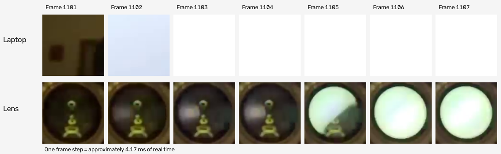
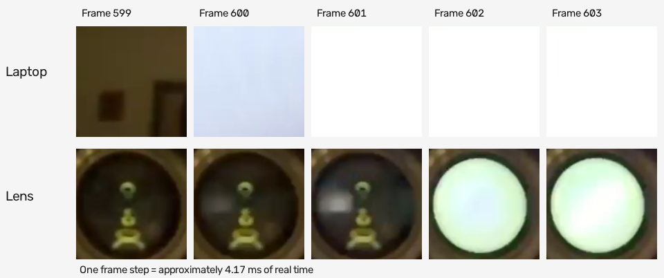

# Measure video delay

Film the monitor and one goggle lens in the same high-speed recording. The time between matching changes is the added monitor-to-lens delay.

## Measured delay

We measured **12.1 ms median added delay** across 20 black/white transitions. The test used native D3D11 capture, DJI Goggles 2 firmware 01.11.00.00, an RTX 5060 Laptop GPU, and a 240 Hz monitor, with no added GPU load. Output was 1920x1080 with a 100 fps encoder target, 20 Mbps limit, and NVENC High/`p4`.

The result uses the 50% brightness crossing in a small patch on each display:

| Transitions | Median | Mean | 95th percentile | Range |
| ---: | ---: | ---: | ---: | --- |
| 20 | 12.1 ms | 10.3 ms | 16.0 ms | 2.1-16.5 ms |

The Windows desktop CLI uses Windows Graphics Capture. For its results, see [earlier desktop measurements](research/EXPERIMENTS.md#monitor-to-lens-delay).

Matching the monitor flashes in the 30 fps export to logged source timestamps gave 240.03 stored frames per second of capture time.

## Count matching transitions

At 240 captured frames per second, one frame step spans about 4.17 ms. Treat the reference frame as frame zero, then count elapsed steps to the matching change in the lens:

```text
delay_ms = (goggles_frame - monitor_frame) * 1000 / capture_fps
```

In this sequence, the laptop is fully white at frame 1103. The lens is partly white at frame 1105 and fully white at frame 1106. Three steps give **12.5 ms**:



### Choose one brightness criterion

Use the same criterion for both displays: a completed change, or a specified point between the dark and bright levels. For automated measurement, sample a patch inside each square and use its local black and white levels. Track the patch if the camera moves.

A completion count can differ from a midpoint measurement. In this sequence, the laptop looks fully white at frame 601 and the lens at frame 602, giving one step, or **4.17 ms**:



The 50% crossings occur at estimated frames 599.60 and 601.50, giving **7.9 ms**. The benchmark uses this midpoint rule for every transition. Fractional frame numbers come from linear interpolation between adjacent brightness samples.

The analysis averages grayscale values in a fixed 30x30-pixel monitor patch and a tracked 16x16-pixel lens patch. Local dark and bright levels come from median values 12-40 frames before and after each monitor transition. Each crossing must stay on the new side of the threshold for three frames.

## Record a test

The supplied desktop test pattern requires FFplay from FFmpeg. On macOS, use the Python interpreter from your virtual environment. To record a measurement, follow these steps:

1. Start the desktop bridge from the repository root:

   ```powershell
   python scripts/stream_desktop.py
   ```

2. In another terminal, start the pattern:

   ```powershell
   python scripts/latency_pattern.py
   ```

   If FFplay isn't on your path, pass `--ffplay "FFPLAY_PATH"`. Replace `FFPLAY_PATH` with the executable's path.

3. Put the pattern on the captured display. Confirm that the square changes on both the monitor and the lens.
4. Select **Slo-mo** at **240 fps** on the camera.
5. Frame both squares at similar heights in the camera image to reduce rolling-shutter timing differences.
6. Keep the camera and goggles steady. Lock focus and exposure so neither square is washed out.
7. Record 20-30 seconds with stream settings and PC activity unchanged.
8. Transfer the unmodified recording. Messaging apps can transcode videos; for example, [Discord compresses mobile uploads](https://support.discord.com/hc/en-us/articles/9665451164951-Video-Upload-Quality-Settings-on-Mobile-FAQ).

The supplied pattern changes every 0.65 seconds. The illustrated native-capture test used logged intervals of 0.65-1.35 seconds. The small counter isn't needed for manual counting. Press **Escape** to close the pattern and **Ctrl+C** to stop the bridge.

## Verify the timing

Inspect the file's stored frame rate before converting frame counts to milliseconds:

```powershell
ffprobe -v error -select_streams v:0 -show_entries stream=avg_frame_rate,r_frame_rate,nb_frames,duration -of default=noprint_wrappers=1 "RECORDING_PATH"
```

Replace `RECORDING_PATH` with the video path. A slow-motion export can report 30 fps while preserving 240 captured frames per second. Check the mapping against the pattern's known cadence or logged transition times. Handle speed ramps separately.

For constant-speed playback, calculate the delay from playback timestamps:

```text
delay_ms = (goggles_playback_seconds - monitor_playback_seconds) * playback_speed * 1000
```

For example, `playback_speed` is `0.125` at 1/8 speed and `0.1` at 10% speed.

Use a viewer that advances one frame at a time. On Windows, this FFplay command adds frame numbers:

```powershell
ffplay -noframedrop -vf "drawtext=fontfile='C\:/Windows/Fonts/consola.ttf':text='%{n}':x=20:y=20:fontsize=40:fontcolor=white:box=1:boxcolor=black" "RECORDING_PATH"
```

Press **P** to pause and **S** to advance a frame. Adjust the font path if Windows is installed elsewhere.

## Report the measurement

Measure at least 20 clear transitions, including black-to-white and white-to-black changes. Save each frame pair and report the median, mean, range, and sample count. Include the hardware, capture path, stream command, camera settings, and any playback-speed correction.

Share cropped frame sequences with the numerical data. Record excluded transitions and their reason, such as an obscured lens.

At 240 fps, the samples are 4.17 ms apart. Exposure, rolling shutter, clipping, and the selected image region affect the crossing time. Interpolation estimates a midpoint between samples; it doesn't provide submillisecond physical accuracy. This test measures display-to-display delay, including scanout and pixel response.
