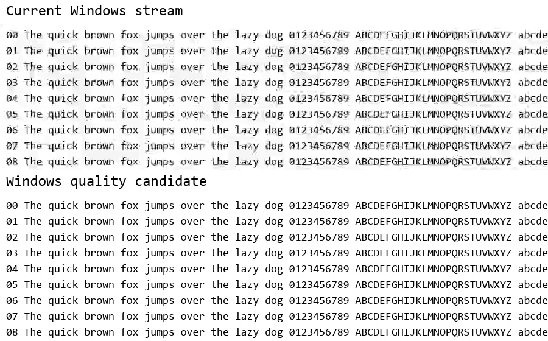

# Windows encoding quality

The Windows defaults improve decoded image quality in synthetic tests while
reducing median host encoding-path delay on the tested PC. The initial headset
comparison did not establish a noticeable improvement. Actual panel cadence
and optical latency still require a matched hardware comparison.

## Encoder changes

Windows uses NVENC High/p1, 32 Mbps CBR, quarter-resolution two-pass rate
control, and single-slice gradual intra refresh. Output stays at 1920x1080 and
100 fps, with a 400,000-bit VBV buffer, no B frames, zero output delay, and
immediate AVI frame delivery. The default recovery interval is three seconds.
The same encoding settings apply to Desktop Duplication. At 60, 75, and 90 fps,
the buffer remains capped at two frames of the previous 20 Mbps budget.
macOS encoding remains unchanged.

Gradual refresh replaces the recurring IDR pictures that caused a visible
quality dip. The first picture is still an IDR. A reconnect starts a new encoder
and therefore a new IDR. The buffer setting is not a guaranteed maximum picture
size; encoded sizes must be checked separately.

Both inspected streams declare three reference frames, three decoded-picture
buffers, zero reordered frames, and a picture-timing output delay of two ticks.
Their SPS timing declares 100 fps. These fields do not measure receiver delay.

## Image quality

Tests used an RTX 5060 Laptop GPU, driver 610.74, and FFmpeg `0893feba65`.
Each configuration encoded the same deterministic reference. Whole-sequence PSNR
comes from FFmpeg's final summary: mean squared pixel error is accumulated
before conversion to decibels. It is not the arithmetic mean of per-frame PSNR.

| Source | Frames per configuration | Previous PSNR | New PSNR | Previous SSIM | New SSIM |
| --- | ---: | ---: | ---: | ---: | ---: |
| Moving test pattern | 1,800 | 45.017 dB | 49.354 dB | 0.995329 | 0.997853 |
| Static text | 1,800 | 43.542 dB | 51.596 dB | 0.999043 | 0.999753 |
| Moving pattern with abrupt changes | 1,800 | 44.825 dB | 49.055 dB | 0.995369 | 0.997825 |
| Fine-detail fractal zoom | 600 | 35.600 dB | 38.391 dB | 0.977695 | 0.986324 |

The abrupt-change source inverts colors at frame 211 of each 347-frame cycle,
then restores them at the next cycle boundary. These transitions do not align with the three-second recovery
interval. All output frames decoded at 1080p with no B frames.

At frame 300, text SSIM rises from 0.938979 to 0.999635. This crop compares
decoded pixels at that frame, with the previous output above and the new output below:



The largest pictures across these four sources were 55,649 bytes for the
previous settings and 42,643 bytes for the new settings. Sustained motion traffic increases: the
moving-texture capture test produced approximately 20.9 versus 32.8 Mbps,
including DUML framing. Smaller observed peak pictures do not eliminate the
extra transmission cost of larger ordinary pictures.

An additional 600-frame comparison at every supported rate improved both
sequence PSNR and mean SSIM for motion, text, and abrupt changes:

| Rate | Motion PSNR, previous to new | Text PSNR, previous to new | Abrupt changes PSNR, previous to new |
| --- | --- | --- | --- |
| 60 fps | 50.619 to 56.028 dB | 43.288 to 50.845 dB | 50.399 to 55.886 dB |
| 75 fps | 47.866 to 52.553 dB | 42.499 to 49.237 dB | 47.650 to 52.377 dB |
| 90 fps | 46.039 to 50.296 dB | 41.285 to 48.021 dB | 45.797 to 50.112 dB |
| 100 fps | 44.988 to 49.290 dB | 41.919 to 47.138 dB | 44.801 to 49.026 dB |

These clips differ in duration across rates, so compare configurations within
each row. Individual new motion pictures can be larger than the previous ones.
The 100 fps motion and text encodes match all 600 pictures from the previously
measured candidate byte for byte.

## Host timing

These runs measured the encoder changes before the capture-pacing change
described in the next section.

Two runs per configuration captured an owned D3D11 window with a moving seeded texture
and a CRC-protected render-submit timestamp. Each run contained 1,800 frames;
the first 100 were excluded. The loaded condition added an offscreen graphics
workload. The table gives the range of the two runs' statistics, not confidence
intervals:

| Condition | Previous median | New median | Previous p95 | New p95 |
| --- | --- | --- | --- | --- |
| Moving texture | 9.119-9.186 ms | 7.968-7.988 ms | 9.782-9.937 ms | 8.694-8.724 ms |
| Moving texture with GPU contention | 11.249-11.405 ms | 10.586-10.692 ms | 17.067-18.864 ms | 18.076-18.160 ms |

Both configurations delivered approximately 100 encoded packets/s. Under contention,
the new median was lower, but the tail ranges overlapped and source duplicates
remained. The synthetic graphics workload completed 237.9-239.9 frames/s with
the previous settings and 235.6-237.4 with the new settings. Source rendering was 181.7-187.5 versus
181.7-182.0 frames/s. These results do not measure simulator performance.

Timing ends when a complete encoded packet reaches the host reader. It excludes
USB transmission and receiver behavior and does not prove unchanged or reduced
optical latency.

The normal bridge and packetizer also carried 900 frames per configuration through a
simulated USB endpoint. Both streams fully decoded; checks covered packet CRCs,
frame reconstruction, encoder shutdown, and the actual logged configuration.
The final defaults additionally passed 600-frame bridge and decoding checks
at each of 60, 75, 90, and 100 fps, including SPS timing and clean shutdown.

## Recovery after capture stalls

Graphics Capture can skip timestamps while its consumer is blocked. FFmpeg's
constant-frame-rate conversion fills that gap with copies of older pictures.
The Windows Graphics Capture path now selects at most one raw frame per target
time slot and assigns consecutive encoder timestamps. It adds no frame buffer
and does not discard encoded H.264 reference pictures.

The selection allows half an input timestamp tick for rounding. `setpts`
also clears the previous frame-duration metadata, which would otherwise cause
an initial duplicate for a source slower than the encoder target. See the
[FFmpeg select and setpts reference](https://ffmpeg.org/ffmpeg-filters.html#select_002c-aselect).
The encoder still declares the requested rate; actual delivery can be lower
when capture is slower or interrupted.

A deterministic check covers 72 cases: four target rates, three source rates,
and gaps of 0, 20, or 200 ms, before and after the change. For a source matching
the target rate, a 200 ms gap previously generated 12, 15, 18, or 20 duplicate
frames at 60, 75, 90, or 100 fps. The new path generates none and preserves every
source frame when the source rate does not exceed the target. At steady rates,
all 4,800 encoded motion and text pictures match the previous quality defaults
byte for byte.

Direct-window Graphics Capture tests used an owned D3D11 moving texture and
CRC-protected timestamps. Each run encoded 900 frames with a 100-frame warmup
and blocked the encoded-output reader for 200 ms after picture 350. Recovery
means the first of five consecutive valid pictures under 20 ms old after the
reader resumes. Two runs per configuration used an old/new/new/old order:

| Target | Previous recovery | New recovery |
| --- | --- | --- |
| 60 fps | 17.3-18.4 ms | 12.6-15.1 ms |
| 75 fps | 22.7-24.6 ms | 12.3-12.7 ms |
| 90 fps | 27.5-28.1 ms | 13.1-13.7 ms |
| 100 fps | 34.2-35.4 ms | 13.5-16.4 ms |

At 100 fps, the next 100 pictures contained 92-93 distinct timestamps before
the change and 100 after it. Normal-delay ranges overlapped; this is a recovery
improvement, not a demonstrated reduction in steady latency. A separate 50 ms
stall comparison showed no consistent improvement. These are direct-window
host measurements, not the monitor-capture or optical measurements above.

Reproduce the frame-ID checks without screen capture, a GPU, or USB:

```powershell
python tools/research/check_frame_pacing.py --output work/frame-pacing.json
```

Use `--ffmpeg` to select the executable. The new results file records the
commands, binary hash, frame counts, and duplicate counts for every case.

## Reproduce the quality comparison

The [comparison tool](../../tools/research/compare_quality.py) uses the actual
bridge encoder command for the new defaults and reconstructs the previous
p4/20 Mbps command by removing the pacing filter, gradual refresh, and multipass encoding.
It never opens USB or captures
the desktop. FFmpeg needs NVENC support; the text source needs Windows Consolas.

```powershell
python tools/research/compare_quality.py --output work/quality-comparison --frames 1800 --sources motion text cuts
python tools/research/compare_quality.py --output work/detail-comparison --frames 600 --sources detail
```

Use `--ffmpeg` if the executable is not on PATH. Choose a new output directory
for each run. The tool saves its commands, FFmpeg hash, encoded clips, metrics
logs, and per-frame results. A null PSNR value denotes a lossless frame or
sequence; `lossless_frames` identifies those frames explicitly.

Use `--fps 60`, `--fps 75`, or `--fps 90` to compare another supported frame rate.
Hardware comparisons need the same simulator workload and the
[optical measurement method](../LATENCY.md).
